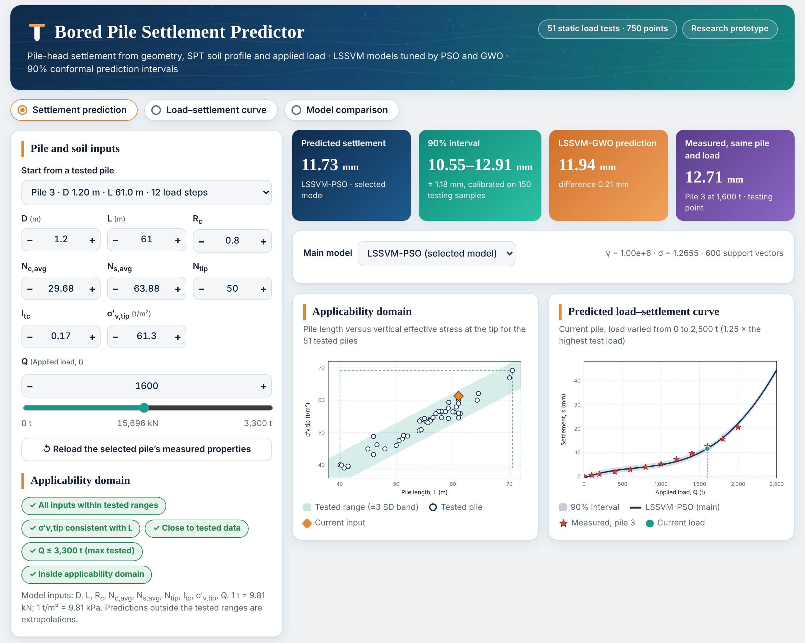

# Bored Pile Settlement Predictor (LSSVM-PSO / LSSVM-GWO)

Graphical user interface and trained models for the study:

> **Hybrid least squares support vector machine models optimised by PSO and GWO for predicting the load–settlement behaviour of bored piles**

The app predicts the pile-head settlement of a bored pile from its geometry, the SPT soil profile and the applied load,
using the trained **LSSVM**, **LSSVM-PSO** and **LSSVM-GWO** models (51 static load tests, 750 load–settlement points).



## Features
- Settlement prediction with a 90% conformal prediction interval (calibrated on the 150 testing samples)
- Predicted load–settlement curve of any pile, with a downloadable table (CSV)
- Comparison of the three models and one-at-a-time sensitivity at the current input
- Applicability-domain check (tested input ranges, σ′v,tip–L consistency, distance to the tested data)

## Inputs
| Symbol | Description | Unit | Tested range |
|---|---|---|---|
| D | Pile diameter | m | 0.80–1.50 |
| L | Pile length | m | 40.1–70.5 |
| R_c | Clay ratio along the shaft | – | 0.42–1.00 |
| N_c,avg | Average SPT N in clay layers | blows/0.3 m | 8.1–34.3 |
| N_s,avg | Average SPT N in sand layers | blows/0.3 m | 0–63.9 |
| N_tip | SPT N at the pile tip | blows/0.3 m | 20–95 |
| I_tc | Tip-clay index | – | 0–1 |
| σ′v,tip | Vertical effective stress at the tip | t/m² | 39.1–69.2 |
| Q | Applied load | t | 0–3,300 |

Output: pile-head settlement s (mm). 1 t = 9.81 kN; 1 t/m² = 9.81 kPa.

## Run locally
```bash
git clone https://github.com/ranjandivesh453/Bored-Pile-Settlement-LSSVM.git
cd Bored-Pile-Settlement-LSSVM
pip install -r requirements.txt
streamlit run app.py
```

## Repository contents
| Path | Content |
|---|---|
| `app.py` | Streamlit GUI |
| `lssvm_model.py` | LSSVM (RBF kernel) class and model loader |
| `models/*.joblib` | Trained models (MinMax scaling + LSSVM) saved from the notebook |
| `models/*_weights.npz`, `models/model_params.json` | Same models as plain arrays (α, b, support vectors, scalers, γ, σ); used if the `.joblib` files cannot be unpickled |
| `notebook/` | Jupyter notebook used to train and evaluate the models |

Optimal hyperparameters: LSSVM-PSO γ = 1.00 × 10⁶, σ = 1.2655; LSSVM-GWO γ = 1.96 × 10⁴, σ = 0.2984.
Testing performance: LSSVM-PSO R² = 0.979, RMSE = 0.764 mm; LSSVM-GWO R² = 0.966, RMSE = 0.964 mm.

## Notes
For research use. Predictions outside the tested ranges are extrapolations; verify with load tests before design.

## Citation
If you use this tool, please cite the paper (details will be added after publication).

## Contact
Divesh Ranjan Kumar, Department of Civil Engineering, Dayananda Sagar College of Engineering, Bengaluru, India
